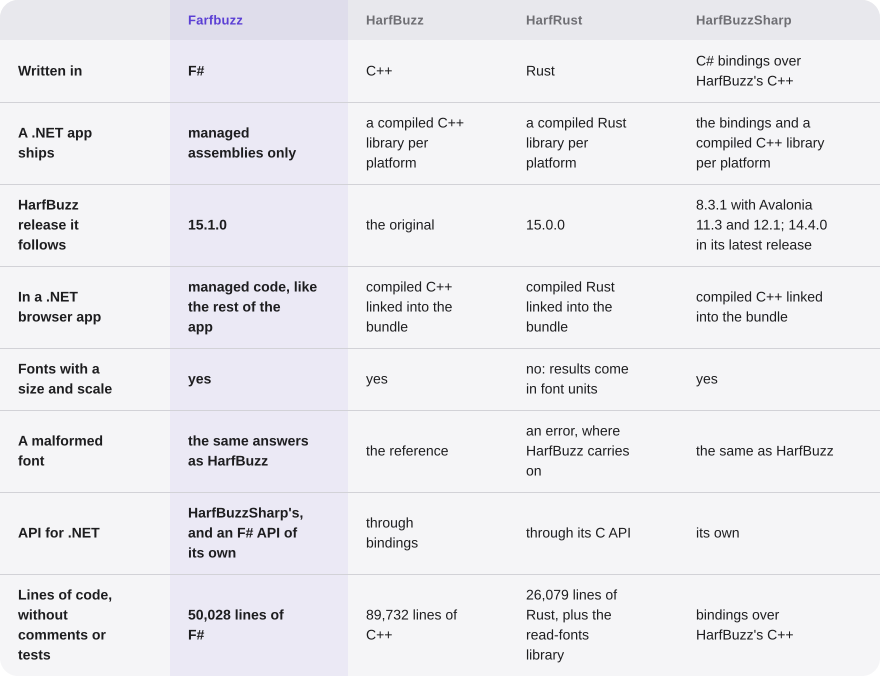
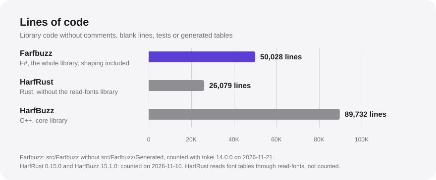
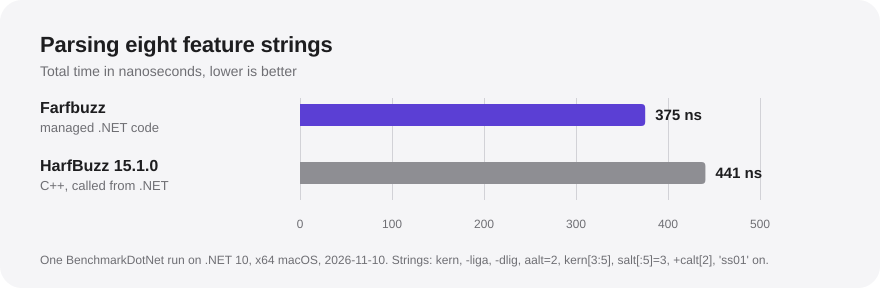
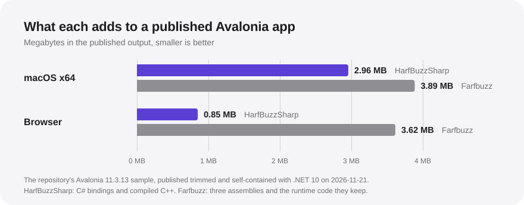
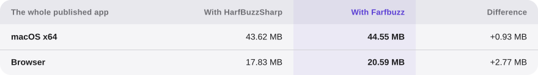
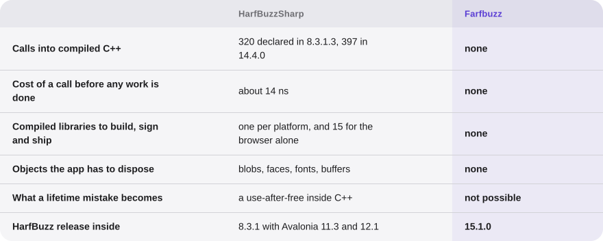
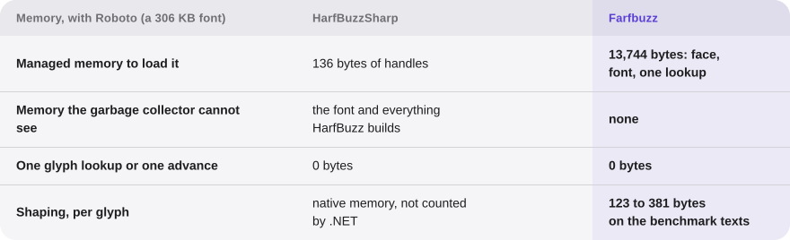
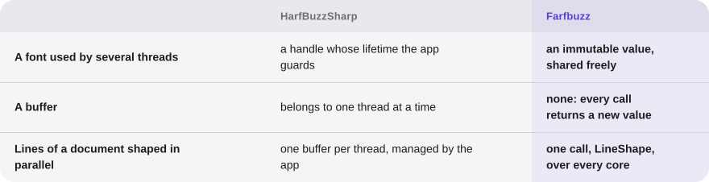

<p align="center"></p>

<h1 align="center">Farfbuzz</h1>

<p align="center">
  <b>A fully managed HarfBuzz for .NET.</b><br>
  A drop-in replacement for HarfBuzzSharp with no native library, for Avalonia, Uno Platform, SkiaSharp and anywhere
  .NET shapes text.
</p>

<p align="center">
  
</p>

<p align="center"><sub>What a text shaper does: characters go in, joined and positioned glyphs come out.</sub></p>

> [!NOTE]
> **Release candidate, 1.0.0-rc.** Text shaping is complete and checked against HarfBuzz 15.1.0. The packages are not
> on NuGet yet: download them from the [1.0.0-rc release](https://github.com/Apogalenos/farfbuzz/releases/tag/v1.0.0-rc)
> or build them (see [Installing](#installing)). All tests were made on an Intel Mac for now.

Farfbuzz is the text shaper [HarfBuzz](https://github.com/harfbuzz/harfbuzz) 15.1.0 rewritten as managed
[.NET](https://dotnet.microsoft.com) code. It shapes OpenType text with every shaper HarfBuzz has (Arabic, the Indic
scripts, Khmer, Myanmar, the Universal Shaping Engine, Hangul, Hebrew, Thai and Lao among them), Apple's AAT tables
(`morx`, `kerx`, `kern`, `trak`) and variable fonts. It runs on .NET 10 from C#, F# or any .NET language, in two ways:

- **as HarfBuzzSharp.** `Farfbuzz.HarfBuzzSharp` is an assembly with the name, the strong-name identity and the public
  API of [HarfBuzzSharp](https://www.nuget.org/packages/HarfBuzzSharp), so code and libraries built for HarfBuzzSharp
  run on it unchanged, with no `libHarfBuzzSharp` beside them;
- **through its own API**, a small set of functions over immutable values, shared safely across threads.

It is written in F#, which is how it is built, not who it is for: nothing in an app needs to be F# to use it.

## Why Farfbuzz

- **Nothing native to ship.** HarfBuzzSharp carries a compiled `libHarfBuzzSharp` for every platform an app targets,
  and links HarfBuzz into the WebAssembly bundle of a browser app. Farfbuzz is managed code only, and goes wherever
  .NET 10 goes.
- **HarfBuzz's behaviour, not an imitation of it.** Farfbuzz reproduces what HarfBuzz 15.1.0 does and is compared with
  HarfBuzz itself, down to rounding and overflow. The intentional differences are listed in
  [DIVERGENCES.md](DIVERGENCES.md).
- **A drop-in for HarfBuzzSharp.** A package switch, with no code changed, replaces HarfBuzzSharp in an app and in the
  libraries it uses.
- **Safe to share across threads.** In the core API, faces, fonts and shaped runs are immutable values: one font can
  serve every thread, and `LineShape` shapes the lines of a document in parallel in one call.
- **No exceptions from the core.** A damaged font or a malformed string is answered with a value (HarfBuzz's own
  fallback, a `voption` or a `Result`), never with an exception or a null. The HarfBuzzSharp assembly throws where
  HarfBuzzSharp's own API does.
- **Ready for trimming and [NativeAOT](https://learn.microsoft.com/dotnet/core/deploying/native-aot/).** No reflection,
  no dynamic code. NativeAOT and browser WebAssembly builds give the same output, glyph for glyph, as the JIT.

## Where it fits

Farfbuzz replaces HarfBuzzSharp wherever an app or a library shapes text through it.

| Where | Shapes through HarfBuzzSharp | Checked with Farfbuzz |
|---|---|---|
| [Avalonia](https://avaloniaui.net) 11 | yes, through Avalonia.Skia | yes: a headless corpus renders byte-identical glyphs (114 glyphs) through both |
| Avalonia 12 | yes, through Avalonia.HarfBuzz | yes: an Avalonia 12.1.1 app, switched by the package alone |
| [Uno Platform](https://platform.uno) | yes, through its Skia renderer | not yet |
| [SkiaSharp](https://github.com/mono/SkiaSharp) apps that draw text with SkiaSharp.HarfBuzz (`SKShaper`) or [RichTextKit](https://github.com/toptensoftware/RichTextKit) | yes | yes, on a four-line corpus: `SKShaper` and RichTextKit give the same glyphs, clusters and positions |
| Shaping with no UI framework: renderers, PDF or image generation, games, servers, WebAssembly | when they use HarfBuzzSharp | the suites above run on the core API, the equivalence run on HarfBuzzSharp's |

A .NET MAUI or WPF app gains only for the text it draws on a SkiaSharp canvas through `SKShaper`; its other text goes
through the platform's text stack (DirectWrite, Core Text, Android), as does text in WinUI and in Blazor pages, which
the browser shapes. Farfbuzz changes nothing there.

## How it compares

<p align="center">
  <picture>
    <source media="(prefers-color-scheme: dark)" srcset="assets/readme/cmp-overview-dark.svg">
    
  </picture>
</p>

<p align="center">
  <picture>
    <source media="(prefers-color-scheme: dark)" srcset="assets/readme/lines-of-code-dark.svg">
    
  </picture>
</p>

The HarfRust column is taken from [its README](https://github.com/harfbuzz/harfrust), which also reports it
"less than 25% slower than HarfBuzz on most common fonts". The line counts leave out comments, blank lines, tests
and generated data tables. Farfbuzz's is the code lines that [tokei](https://github.com/XAMPPRocky/tokei) 14.0.0
counts in `src/Farfbuzz` without `src/Farfbuzz/Generated` (158 files, counted on 2026-11-21); the HarfBuzzSharp
assembly and its bridge add 3,634 lines of C# and 839 lines of F#. HarfBuzz's is its core library; HarfRust's is
version 0.15.0, which reads font tables through the separate read-fonts library. Those two were counted on 2026-11-10.

## Measured against HarfBuzz

<p align="center">
  <picture>
    <source media="(prefers-color-scheme: dark)" srcset="assets/readme/proof-dark.svg">
    
  </picture>
</p>

Every comparison runs both libraries on the same input and demands the same output. The figures are those of the
full build of 2026-11-21:

- **HarfBuzz's own shaping suites:** 5,850 of 5,850 runs pass (in-house 5,137, aots 276, text-rendering-tests 437).
- **Differential tests against HarfBuzz 15.1.0**, built from the `upstream/harfbuzz` submodule and called on the same
  fonts and text: 3,302 tests pass, among them thousands of fonts damaged on purpose, which must be accepted, refused
  and shaped as HarfBuzz does.
- **Unit and property tests:** 2,895 pass (7 ignored); the public API is pinned by 5 tests.
- **The HarfBuzzSharp assembly:** ApiCompat, in strict mode against HarfBuzzSharp 14.4.0, reports no breaking change;
  its output equals the real HarfBuzzSharp's on 5,840 shaping cases; Avalonia 11 renders a headless corpus
  byte-identical through both; every HarfBuzzSharp reference made by Avalonia.Skia 11.3.13 (60 references),
  Avalonia.HarfBuzz 12.1.1 (44), SkiaSharp.HarfBuzz 3.116.1 (36) and Topten.RichTextKit 0.4.167 (35) resolves in it.

Where Farfbuzz does differ, [DIVERGENCES.md](DIVERGENCES.md) says how and why. The two a caller can meet: a buffer
that has run out of its length limit or operation budget is left in a different state before the lookups (D-11), and
the HarfBuzzSharp assembly ignores the `Verify` buffer flag and throws `NotSupportedException` where the core reports
a glyph outline it cannot read yet, which concerns VARC fonts (D-P10-6, D-7).

### Speed

<p align="center">
  <picture>
    <source media="(prefers-color-scheme: dark)" srcset="assets/readme/cmp-speed-dark.svg">
    
  </picture>
</p>

<p align="center">
  <picture>
    <source media="(prefers-color-scheme: dark)" srcset="assets/readme/speed-ratios-dark.svg">
    
  </picture>
</p>

Time to shape every line of a text once, on the ten texts of HarfBuzz's own shaping benchmark. A ratio below 1×
means Farfbuzz takes less time. The middle columns and the first ratio are
[BenchmarkDotNet](https://github.com/dotnet/BenchmarkDotNet) means on .NET 10 with the JIT, against HarfBuzz 15.1.0's
C++ called from .NET; the last column is the median pass of a NativeAOT app against the same app on the
HarfBuzzSharp 14.4.0 package. Every pair gives the same glyphs as HarfBuzz.

- **Latin and variable fonts:** Farfbuzz takes 0.70× to 0.75× of HarfBuzz's time.
- **Arabic, Persian and Urdu:** Amiri 1.10×, Gulzar 1.08× and 1.64×, Noto Nastaliq Urdu 1.48× and 1.56×.
- **Devanagari** 1.40×, **Duployan** 1.40×.
- **Other scripts**, timed by the project's own runner (the fastest of nine rounds): Thai 1.34×, Khmer 1.31×,
  Myanmar 1.33×, Hebrew 1.40×, Newa 1.46×, Balinese 1.52×, Tibetan 1.52×, Kannada 1.58×, Telugu 1.66×, Hangul 1.77×.
- **NativeAOT, against the HarfBuzzSharp 14.4.0 package:** faster on 8 of the 10 texts (0.35× to 0.77×), slower on
  Amiri (1.09×) and Devanagari (1.54×).
- **Browser WebAssembly:** compiled ahead of time, Farfbuzz takes 1.25× to 4.14× the time of the HarfBuzzSharp
  14.4.0 package, whose HarfBuzz is compiled C++; under the WebAssembly interpreter, 6.34× to 24.0×.
- **Memory:** shaping a line allocates 123 to 381 bytes a glyph on the ten texts; `LineShape`, the document entry,
  allocates 41.3 to 48.0 bytes a glyph on the two English texts and 266.3 bytes a glyph on the Hindi words.
- **Font functions:** a single horizontal advance takes 1.8 to 2.1 ns against HarfBuzz's 1.3 to 1.5 ns, a single
  vertical advance 1.3 to 1.4 ns against 0.2 to 0.5 ns. `Font.hAdvancesInto`, which writes the advances of many glyphs
  into an array the caller owns, takes 1.1 to 1.2 ns a glyph against HarfBuzz's 1.3 to 1.5 ns. On a variable font at
  `wght=500`, a horizontal advance takes 4.7 to 5.0 ns against HarfBuzz's 11.0 to 81.7 ns.

Measured on 2026-11-21 on an Intel Core i9-9880H under macOS, .NET 10.0.12, on a quiet machine.

<p align="center">
  <picture>
    <source media="(prefers-color-scheme: dark)" srcset="assets/readme/feature-parsing-dark.svg">
    
  </picture>
</p>

Parsing eight feature strings such as `kern[3:5]`: 375 ns against 441 ns for HarfBuzz 15.1.0's C++
(BenchmarkDotNet, .NET 10, x64 macOS, 2026-11-10).

## What changes in a published app

<p align="center">
  <picture>
    <source media="(prefers-color-scheme: dark)" srcset="assets/readme/app-size-dark.svg">
    
  </picture>
</p>

An Avalonia app published with Farfbuzz comes out 0.93 MB larger on macOS x64 and 2.77 MB larger in the browser,
FSharp.Core included (0.30 MB and 0.23 MB trimmed).

<p align="center">
  <picture>
    <source media="(prefers-color-scheme: dark)" srcset="assets/readme/cmp-app-dark.svg">
    
  </picture>
</p>

### Calls out of .NET

<p align="center">
  <picture>
    <source media="(prefers-color-scheme: dark)" srcset="assets/readme/cmp-calls-dark.svg">
    
  </picture>
</p>

### Memory

<p align="center">
  <picture>
    <source media="(prefers-color-scheme: dark)" srcset="assets/readme/cmp-memory-dark.svg">
    
  </picture>
</p>

HarfBuzzSharp's 136 bytes were measured on 2026-11-10; Farfbuzz's figures on 2026-11-21.

### Threads

<p align="center">
  <picture>
    <source media="(prefers-color-scheme: dark)" srcset="assets/readme/cmp-threads-dark.svg">
    
  </picture>
</p>

`LineShape` gives each line the glyphs it has when shaped alone, and shapes on the calling thread below a measured
size and in the browser, which has no threads by default.

## Release 1.0.0-rc

22 November 2026. The first release candidate.

- Text shaping complete: OpenType with every HarfBuzz shaper, Apple's AAT tables and variable fonts.
- Checked against HarfBuzz 15.1.0: 5,850 of 5,850 shaping tests, 3,302 differential tests.
- Three packages: `Farfbuzz`, `Farfbuzz.HarfBuzzSharp` (the HarfBuzzSharp 14.4.0 API, a drop-in) and
  `Farfbuzz.HarfBuzzSharp.Bridge`.
- Known limits: complex scripts take 1.08× to 1.77× HarfBuzz's time, shaping allocates 123 to 381 bytes a glyph, browser
  builds are slower than HarfBuzzSharp's compiled C++. Intentional differences are in [DIVERGENCES.md](DIVERGENCES.md).
- Tested on an Intel Mac only.

## Installing

The three packages, `Farfbuzz`, `Farfbuzz.HarfBuzzSharp.Bridge` and `Farfbuzz.HarfBuzzSharp`, version 1.0.0-rc,
are built from this repository:

```bash
dotnet fsi build.fsx package  # packs them into artifacts/package/nupkg and installs the facade in an outside consumer
```

Then add that folder as a package source, in a `nuget.config` next to the app's solution:

```xml
<configuration>
  <packageSources>
    <add key="farfbuzz" value="path/to/farfbuzz/artifacts/package/nupkg" />
  </packageSources>
  <packageSourceMapping>
    <packageSource key="farfbuzz">
      <package pattern="Farfbuzz" />
      <package pattern="Farfbuzz.*" />
    </packageSource>
    <packageSource key="nuget.org">
      <package pattern="*" />
    </packageSource>
  </packageSourceMapping>
</configuration>
```

`Farfbuzz.HarfBuzzSharp` brings the other two with it. A program that uses only Farfbuzz's own API references
`Farfbuzz`.

## Using it in an app

### Switch the package, change no code

`Farfbuzz.HarfBuzzSharp` replaces HarfBuzzSharp for the app and for every package it uses that depends on
HarfBuzzSharp: Avalonia 11 (through Avalonia.Skia), Avalonia 12 (through Avalonia.HarfBuzz), SkiaSharp.HarfBuzz,
RichTextKit. Nothing is recompiled. A build switch keeps both libraries within reach, which makes them easy to compare.

`Directory.Build.props`, next to the solution:

```xml
<Project>
  <PropertyGroup Condition="'$(UseFarfbuzz)' == 'true'">
    <!-- keeps HarfBuzz's compiled C++ out of an Avalonia browser bundle -->
    <ShouldIncludeNativeHarfBuzzSharp>false</ShouldIncludeNativeHarfBuzzSharp>
  </PropertyGroup>

  <ItemGroup Condition="'$(UseFarfbuzz)' == 'true'">
    <!-- the managed replacement: same assembly name, same API -->
    <PackageReference Include="Farfbuzz.HarfBuzzSharp" Version="1.0.0-rc" />

    <!-- stops NuGet from restoring the original and its compiled libraries -->
    <PrunePackageReference Include="HarfBuzzSharp" Version="99.0.0" />
    <PrunePackageReference Include="HarfBuzzSharp.NativeAssets.Win32" Version="99.0.0" />
    <PrunePackageReference Include="HarfBuzzSharp.NativeAssets.macOS" Version="99.0.0" />
    <PrunePackageReference Include="HarfBuzzSharp.NativeAssets.Linux" Version="99.0.0" />
    <PrunePackageReference Include="HarfBuzzSharp.NativeAssets.WebAssembly" Version="99.0.0" />
    <PrunePackageReference Include="HarfBuzzSharp.NativeAssets.Android" Version="99.0.0" />
    <PrunePackageReference Include="HarfBuzzSharp.NativeAssets.iOS" Version="99.0.0" />
    <PrunePackageReference Include="HarfBuzzSharp.NativeAssets.MacCatalyst" Version="99.0.0" />
    <PrunePackageReference Include="HarfBuzzSharp.NativeAssets.tvOS" Version="99.0.0" />
    <PrunePackageReference Include="HarfBuzzSharp.NativeAssets.Tizen" Version="99.0.0" />
  </ItemGroup>
</Project>
```

```bash
dotnet run --project MyApp.Desktop -p:UseFarfbuzz=true    # Farfbuzz
```

```bash
dotnet run --project MyApp.Desktop -p:UseFarfbuzz=false   # HarfBuzzSharp, as before
```

The version is written out because a prerelease is never matched by a pattern such as `1.*`.

### Avalonia 11 and 12

[Avalonia](https://github.com/AvaloniaUI/Avalonia) is the first integration tested. Both lines shape through
HarfBuzzSharp: [Avalonia](https://www.nuget.org/packages/Avalonia) 11.3 through Avalonia.Skia, Avalonia 12.1 through
Avalonia.HarfBuzz, each on HarfBuzzSharp 8.3.1.3. The switch above is all either needs. With it, Avalonia 11.3.13
renders the project's headless corpus with the same glyphs as with HarfBuzzSharp, and an Avalonia 12.1.1 app ran on
the facade with no native HarfBuzz library loaded.

Avalonia 12 can also take its text shaper from the app builder, which needs no assembly replaced.
`src/Farfbuzz.Avalonia` implements Avalonia's text shaper on Farfbuzz's own API and adds `UseFarfbuzz()`; its output
equals HarfBuzz's on the project's Avalonia 12.1.1 corpus (164 glyph lines). It is not packaged: it compiles against
Avalonia's private APIs and is pinned to Avalonia 12.1.1 exactly, so it is used from a clone of this repository, by a
project reference to `src/Farfbuzz.Avalonia/Farfbuzz.Avalonia.csproj`. Call it after `UsePlatformDetect()`: the last
shaper registered wins.

<p></p>

```csharp
public static AppBuilder BuildAvaloniaApp() =>
    AppBuilder.Configure<App>()
        .UsePlatformDetect()
        .UseFarfbuzz();
```

<p></p>

```fsharp
let buildAvaloniaApp () =
    AppBuilder.Configure<App>().UsePlatformDetect().UseFarfbuzz()
```

### Uno Platform

[Uno Platform](https://github.com/unoplatform/uno)'s Skia renderer shapes through HarfBuzzSharp, so the same switch
applies: put it in the Uno app's `Directory.Build.props`. Not yet tried in an Uno app.

### SkiaSharp

SkiaSharp.HarfBuzz's `SKShaper` and RichTextKit take HarfBuzzSharp from the same switch. On the project's four-line
corpus, both give the same glyphs, clusters and positions with Farfbuzz as with HarfBuzzSharp (SkiaSharp.HarfBuzz
3.119.1, Topten.RichTextKit 0.4.167).

### In the browser

An Avalonia browser app links HarfBuzz's compiled C++ into its WebAssembly bundle. With the switch, HarfBuzz leaves
that link, and text is shaped by the same managed code as on the desktop, with no Blazor involved. SkiaSharp keeps
its own link.

## Using it from code

There are two ways in, and both run the same engine. Code written for HarfBuzzSharp stays as it is; only the assembly
behind it changes. Farfbuzz's own API adds a `Font` shared safely across threads, documents shaped in parallel, errors
returned as values, and tags the compiler checks.

<p></p>

The HarfBuzzSharp API, unchanged, running on `Farfbuzz.HarfBuzzSharp`:

```csharp
using System;
using HarfBuzzSharp;

using var blob = Blob.FromFile("Roboto-Regular.ttf");
using var face = new Face(blob, 0);
using var font = new Font(face);
using var buffer = new HarfBuzzSharp.Buffer();

buffer.AddUtf16("Hello, office");
buffer.GuessSegmentProperties();
font.Shape(buffer);

var infos = buffer.GetGlyphInfoSpan();
var positions = buffer.GetGlyphPositionSpan();
for (var i = 0; i < infos.Length; i++)
    Console.WriteLine($"glyph {infos[i].Codepoint}, cluster {infos[i].Cluster}, advance {positions[i].XAdvance}");
```

```text
glyph 45, cluster 0, advance 1461
glyph 74, cluster 1, advance 1086
glyph 81, cluster 2, advance 498
glyph 81, cluster 3, advance 498
glyph 84, cluster 4, advance 1168
glyph 17, cluster 5, advance 403
glyph 5, cluster 6, advance 508
glyph 84, cluster 7, advance 1168
glyph 1833, cluster 8, advance 1748
glyph 72, cluster 11, advance 1072
glyph 74, cluster 12, advance 1086
```

Glyph 1833 is Roboto's "ffi" ligature: thirteen characters give eleven glyphs. Advances are in font units.

<p></p>

Farfbuzz's own API, shaping one line:

```fsharp
open System
open System.Collections.Immutable
open System.IO
open System.Text
open Farfbuzz

let face = Face.create (ReadOnlyMemory (File.ReadAllBytes "Roboto-Regular.ttf")) 0u
let font = Font.create face

let text = Encoding.UTF8.GetBytes "Hello, office"
let run =
    GlyphRun.addUtf8 (ReadOnlySpan text) 0 text.Length GlyphRun.empty
    |> GlyphRun.guessSegmentProperties Language.cLocale

match Shape.shape font ImmutableArray.Empty run with
| Ok shaped ->
    for info, position in Seq.zip (GlyphRun.infos shaped) (GlyphRun.positions shaped) do
        printfn $"glyph {info.Codepoint}, cluster {info.Cluster}, advance {position.XAdvance}"
| Error error -> printfn $"could not shape: {error}"
```

It prints the same eleven lines as the C# above. Reading the font and parsing a feature, with the same `font`:

```fsharp
match Feature.parse "-liga", Font.nominalGlyph font (uint32 'A') with
| Ok noLigatures, ValueSome glyph ->
    printfn $"{Feature.format noLigatures}; A is glyph {glyph}, {Font.hAdvance font glyph} font units wide"
| Error error, _ -> printfn $"not a feature: {error}"
| _, ValueNone -> printfn "this font has no A"
```

```text
-liga; A is glyph 38, 1336 font units wide
```

Shaping the lines of a document in one call, over every core (`0` lets `LineShape` use them all):

```fsharp
let lines = [| "Hello, office"; "Waffles for the staff" |]
let document = Encoding.UTF8.GetBytes (String.Join ("\n", lines))
let starts = lines |> Array.scan (fun start line -> start + Encoding.UTF8.GetByteCount (line: string) + 1) 0
let bounds = ImmutableArray.CreateRange (lines |> Array.mapi (fun index line -> struct (starts[index], Encoding.UTF8.GetByteCount line)))

let struct (shapedDocument, _) =
    LineShape.utf8 0 PlanCache.empty font ImmutableArray.Empty ValueNone Language.cLocale GlyphRun.empty (ReadOnlyMemory document) bounds

for index in 0 .. lines.Length - 1 do
    match ShapedDocument.errorOf shapedDocument index with
    | ValueNone -> printfn $"line {index}: {(ShapedDocument.infosOf shapedDocument index).Length} glyphs"
    | ValueSome error -> printfn $"line {index}: {error}"
```

```text
line 0: 11 glyphs
line 1: 19 glyphs
```

The whole public API is listed in [docs/api.md](docs/api.md).

## Design

- **Pure functions over immutable values.** The same input always gives the same output, and nothing changes
  after it is created.
- **HarfBuzz's own layouts.** `GlyphInfo`, `GlyphPosition` and `Feature` have exactly the size and field order
  of their HarfBuzz counterparts, so existing HarfBuzzSharp code reads them without conversion.
- **The same data as HarfBuzz.** Data tables are generated from the source files HarfBuzz itself is built
  from, never typed by hand.
- **HarfBuzz's names.** Functions and types keep the names they have upstream, so the two code bases can be
  read side by side.
- **A thin HarfBuzzSharp shell.** `Farfbuzz.HarfBuzzSharp` is C# that declares HarfBuzzSharp's API and holds its
  buffer state; every computation goes to the F# core through `Farfbuzz.HarfBuzzSharp.Bridge`.
- **Not included:** the subsetter, the rendering libraries, and the shapers that belong to a platform
  (Core Text, DirectWrite, Uniscribe, Graphite). Line breaking, bidi and font fallback are not HarfBuzz's job,
  so they are not Farfbuzz's.

## How it is built: what F# brings

Farfbuzz is written in F#. Each item sets a piece of HarfBuzz beside the F# that does the same job in Farfbuzz, with
links to both sources and to the F# language reference. HarfBuzz shapes most of the text on today's screens, and its
code is followed here line by line, with gratitude to [Behdad Esfahbod](https://github.com/behdad) and the
[HarfBuzz authors](https://github.com/harfbuzz/harfbuzz/blob/15.1.0/AUTHORS). The comparisons are about what
each language checks for its author, not about the quality of HarfBuzz, which sets the standard.

<details>
<summary><b>Units of measure</b>: a tag and a script cannot be mixed up</summary>

To the C++ compiler a tag is any 32-bit number, and a script, being an `enum`, becomes one without a cast. Each
of the three statements below compiles without a warning and runs without an error; it simply does not do what
was meant:

<p></p>

```cpp
typedef uint32_t hb_tag_t;

typedef enum
{
  /* … */
  HB_SCRIPT_ARABIC = HB_TAG ('A','r','a','b'),
  /* … */
} hb_script_t;

// A script where a table tag was meant: the table comes back empty.
hb_blob_t *table = hb_face_reference_table (face, HB_SCRIPT_ARABIC);

// A script where a feature tag was meant: there is no feature 'Arab', so nothing changes.
hb_feature_t feature = { HB_SCRIPT_ARABIC, 1, 0, (unsigned) -1 };

// An OpenType script tag compared with a script: never equal, because 'arab' is not 'Arab'.
bool arabic = script_tag == HB_SCRIPT_ARABIC;
```

Farfbuzz marks tags and scripts with units of measure. At run time they are still plain 32-bit numbers, but the
same three statements do not build, and turning one into the other has to be asked for by name, with
`Script.ofIso15924`:

<p></p>

```fsharp
[<Measure>] type tag
[<Measure>] type script

type Tag = uint32<tag>
type Script = uint32<script>

let table = Face.referenceTable face Scripts.Arabic
let feature = { Tag = Scripts.Arabic; Value = 1u; Start = 0u; End = UInt32.MaxValue }
let arabic = (scriptTag = Scripts.Arabic)
// Each of the three is refused:
// error FS0001: The unit of measure 'tag' does not match the unit of measure 'script'
```

HarfBuzz: [`src/hb-common.h`](https://github.com/harfbuzz/harfbuzz/blob/15.1.0/src/hb-common.h#L184), [`src/hb-script-list.h`](https://github.com/harfbuzz/harfbuzz/blob/15.1.0/src/hb-script-list.h#L243-L249) · Farfbuzz: [`src/Farfbuzz/Tag.fs`](src/Farfbuzz/Tag.fs#L6-L11), [`src/Farfbuzz/Generated/Scripts.fs`](src/Farfbuzz/Generated/Scripts.fs#L10-L13) · F# reference: [Units of measure](https://learn.microsoft.com/dotnet/fsharp/language-reference/units-of-measure)

</details>

<details>
<summary><b>Active patterns</b>: the three outcomes of a comparison have names</summary>

The binary search over a font table, each function whole. In C++ the outcome is an `int` tested twice, the
bounds are changed in place, each record is reached by casting pointers, and the answer leaves through a pointer:

<p></p>

```cpp
template <typename V, typename K, typename ...Ts>
HB_HOT
static inline bool
hb_bsearch_impl (unsigned *pos, /* Out */
                 const K& key,
                 V* base, size_t nmemb, size_t stride,
                 int (*compar)(const void *_key, const void *_item, Ts... _ds),
                 Ts... ds)
{
  int min = 0, max = (int) nmemb - 1;
  while (min <= max)
  {
    int mid = ((unsigned int) min + (unsigned int) max) / 2;
#pragma GCC diagnostic push
#pragma GCC diagnostic ignored "-Wcast-align"
    V* p = (V*) (((const char *) base) + (mid * stride));
#pragma GCC diagnostic pop
    int c = compar ((const void *) std::addressof (key), (const void *) p, ds...);
    if (c < 0)
      max = mid - 1;
    else if (c > 0)
      min = mid + 1;
    else
    {
      *pos = mid;
      return true;
    }
  }
  *pos = min;
  return false;
}
```

In F# an active pattern names the three outcomes and the match has to cover them all; nothing is cast, and the
answer is the value returned. The C++ spells out three template parameters and the type of every argument; the
F# states the constraint on the comparer, the span and the result, and the compiler infers the bounds. The C++ also
reports where a missing key would be inserted; the F# answers only whether the key is there, and where:

<p></p>

```fsharp
let inline (|Ordered|) (comparison) : Order =
    match comparison with
    | comparison when comparison < 0 -> Before
    | comparison when comparison > 0 -> After
    | _ -> Equal

[<TailCall>]
let rec bsearch<'C when 'C : struct and 'C :> IRecordComparer>
        (comparer: 'C) (data: ReadOnlySpan<byte>) (lo) (hi) : int voption =
    match lo > hi with
    | true -> ValueNone
    | false ->
        let mid = int ((uint32 lo + uint32 hi) >>> 1)
        match comparer.Compare(data, mid) with
        | Ordered Before -> bsearch comparer data lo (mid - 1)
        | Ordered After -> bsearch comparer data (mid + 1) hi
        | Ordered Equal -> ValueSome mid
```

HarfBuzz: [`src/hb-algs.hh`](https://github.com/harfbuzz/harfbuzz/blob/15.1.0/src/hb-algs.hh#L1404-L1436) · Farfbuzz: [`src/Farfbuzz/Binary.fs`](src/Farfbuzz/Binary.fs#L27-L118) · F# reference: [Active patterns](https://learn.microsoft.com/dotnet/fsharp/language-reference/active-patterns), [Type inference](https://learn.microsoft.com/dotnet/fsharp/language-reference/type-inference)

</details>

<details>
<summary><b>Unions the compiler checks</b>: a direction is one of five cases, not a number</summary>

The type and the function that reverses it. In C++ a direction is a number, and reversing it is a bit flip that
works only because of the numbers chosen. Reversing `HB_DIRECTION_INVALID` gives 1, which is no direction at all:

<p></p>

```cpp
typedef enum {
  HB_DIRECTION_INVALID = 0,
  HB_DIRECTION_LTR = 4,
  HB_DIRECTION_RTL,
  HB_DIRECTION_TTB,
  HB_DIRECTION_BTT
} hb_direction_t;

#define HB_DIRECTION_REVERSE(dir) ((hb_direction_t) (((unsigned int) (dir)) ^ 1))
```

In F# every case is written out, `Invalid` included, and the build refuses a match that forgets one:

<p></p>

```fsharp
[<Struct>]
type Direction =
    | Invalid
    | Ltr
    | Rtl
    | Ttb
    | Btt

let reverse (direction: Direction) =
    match direction with
    | Invalid -> Invalid
    | Ltr -> Rtl
    | Rtl -> Ltr
    | Ttb -> Btt
    | Btt -> Ttb
```

HarfBuzz: [`src/hb-common.h`](https://github.com/harfbuzz/harfbuzz/blob/15.1.0/src/hb-common.h#L256-L324) · Farfbuzz: [`src/Farfbuzz/Common.fs`](src/Farfbuzz/Common.fs#L8-L83) · F# reference: [Discriminated unions](https://learn.microsoft.com/dotnet/fsharp/language-reference/discriminated-unions), [Pattern matching](https://learn.microsoft.com/dotnet/fsharp/language-reference/pattern-matching)

</details>

<details>
<summary><b>Tail recursion</b>: a loop whose whole state is in its parameters</summary>

Scanning the digits of a number, each function whole. The C++ changes four variables as it goes and hands back
four results, three of them through pointers:

<p></p>

```cpp
static const char *
_hb_scan_digits (const char *p, const char *pe, int base,
                 uint64_t *value, bool *overflow, bool *any_digits)
{
  const uint64_t cutoff = UINT64_MAX / (unsigned) base;
  const uint64_t cutlim = UINT64_MAX % (unsigned) base;
  uint64_t v = 0;
  bool ov = false, any = false;

  for (; p < pe; p++)
  {
    int d = _hb_digit_value (*p, base);
    if (d < 0) break;
    any = true;
    if (v > cutoff || (v == cutoff && (uint64_t) d > cutlim))
      ov = true;
    else
      v = v * (unsigned) base + (uint64_t) d;
  }

  *value = v;
  *overflow = ov;
  *any_digits = any;
  return p;
}
```

The F# has no variable to change: each turn is a call with the new state, and the four results come back as one
record. `[<TailCall>]` has the compiler report any call that would grow the stack, so this compiles to a loop:

<p></p>

```fsharp
[<Struct>]
type Digits = { Next: int; Value: uint64; Overflow: bool; Any: bool }

[<TailCall>]
let rec private scanDigitsFrom
        (text: ReadOnlySpan<byte>) (numberBase: int) (index: int) (value: uint64) (overflow: bool) (any: bool)
        (cutoff: uint64) (cutlim: uint64) : Digits =
    let digit = if index < text.Length then digitValue text[index] numberBase else -1
    match digit with
    | -1 -> { Next = index; Value = value; Overflow = overflow; Any = any }
    | d ->
        let overflows = value > cutoff || (value = cutoff && uint64 d > cutlim)
        let next = if overflows then value else value * uint64 numberBase + uint64 d
        scanDigitsFrom text numberBase (index + 1) next (overflow || overflows) true cutoff cutlim

let scanDigits (text: ReadOnlySpan<byte>) (numberBase: int) (index: int) (value: uint64) (overflow: bool) (any: bool) : Digits =
    let cutoff = UInt64.MaxValue / uint64 numberBase
    let cutlim = UInt64.MaxValue % uint64 numberBase
    scanDigitsFrom text numberBase index value overflow any cutoff cutlim
```

HarfBuzz: [`src/hb-number.cc`](https://github.com/harfbuzz/harfbuzz/blob/15.1.0/src/hb-number.cc#L69-L93) · Farfbuzz: [`src/Farfbuzz/Number.fs`](src/Farfbuzz/Number.fs#L69-L106) · F# reference: [Recursive functions and tail calls](https://learn.microsoft.com/dotnet/fsharp/language-reference/functions/recursive-functions-the-rec-keyword)

</details>

<details>
<summary><b>Shadowing, struct tuples and <code>inline</code></b>: a parser with no pointer to a pointer</summary>

One stage of the feature parser, and the function that chains the stages. Each C++ stage moves a shared position
through a pointer to a pointer and fills the feature through another, so what a call changed cannot be seen where
it is called:

<p></p>

```cpp
static bool
parse_char (const char **pp, const char *end, char c)
{
  parse_space (pp, end);

  if (*pp == end || **pp != c)
    return false;

  (*pp)++;
  return true;
}

static bool
parse_one_feature (const char **pp, const char *end, hb_feature_t *feature)
{
  return parse_feature_value_prefix (pp, end, feature) &&
         parse_tag (pp, end, &feature->tag) &&
         parse_feature_indices (pp, end, feature) &&
         parse_feature_value_postfix (pp, end, feature) &&
         parse_space (pp, end) &&
         *pp == end;
}
```

In F# every stage takes the position and returns the new one beside its value, and `p` is simply bound again on
the next line. `inline` fuses the stages into one function, and nothing is allocated:

<p></p>

```fsharp
let inline char (text: ReadOnlySpan<byte>) (p) (expected) : struct (bool * int) =
    let at = spaces text p
    if uint at < uint text.Length && text[at] = expected then struct (true, at + 1) else struct (false, at)

let tryParse (text: ReadOnlySpan<byte>) : Feature voption =
    let struct (implied, p) = prefix text
    let struct (name, p) = Cursor.tag text p
    let struct (start, stop, p) = indices text p
    let struct (value, p) = postfix text p implied
    if Cursor.spaces text p = text.Length then
        ValueSome { Tag = LanguagePrimitives.UInt32WithMeasure name; Value = value; Start = start; End = stop }
    else
        ValueNone
```

HarfBuzz: [`src/hb-common.cc`](https://github.com/harfbuzz/harfbuzz/blob/15.1.0/src/hb-common.cc#L711-L869) · Farfbuzz: [`src/Farfbuzz/Syntax.fs`](src/Farfbuzz/Syntax.fs#L131-L133), [`src/Farfbuzz/Feature.fs`](src/Farfbuzz/Feature.fs#L88-L96) · F# reference: [Functions (shadowing)](https://learn.microsoft.com/dotnet/fsharp/language-reference/functions/), [Tuples (struct tuples)](https://learn.microsoft.com/dotnet/fsharp/language-reference/tuples), [Inline functions](https://learn.microsoft.com/dotnet/fsharp/language-reference/functions/inline-functions)

</details>

<details>
<summary><b>Records with C's layout</b>: the same 16 bytes, immutable and compared by value</summary>

The type, a change to one field, and a comparison. The C struct is changed in place, for every piece of code
that holds a pointer to it, and two of them are compared a field at a time, because `a == b` does not compile:

<p></p>

```cpp
typedef struct hb_feature_t {
  hb_tag_t      tag;
  uint32_t      value;
  unsigned int  start;
  unsigned int  end;
} hb_feature_t;

feature->value = 0;
bool same = a.tag == b.tag && a.value == b.value && a.start == b.start && a.end == b.end;
```

The F# record has exactly those 16 bytes, so it crosses to C unchanged. A change gives a new value and leaves
the old one as it was, and `=` compares all four fields:

<p></p>

```fsharp
[<Struct; StructLayout(LayoutKind.Sequential)>]
type Feature =
    {
        Tag: Tag       // the feature tag, for example liga
        Value: uint32  // 0 turns the feature off, 1 on; larger values pick alternates
        Start: uint32  // the first cluster the setting applies to
        End: uint32    // the cluster after the last one it applies to
    }

let off = { feature with Value = 0u }
let same = (a = b)
```

HarfBuzz: [`src/hb-common.h`](https://github.com/harfbuzz/harfbuzz/blob/15.1.0/src/hb-common.h#L437-L442) · Farfbuzz: [`src/Farfbuzz/Feature.fs`](src/Farfbuzz/Feature.fs#L11-L18) · F# reference: [Records](https://learn.microsoft.com/dotnet/fsharp/language-reference/records), [Copy and update record expressions](https://learn.microsoft.com/dotnet/fsharp/language-reference/copy-and-update-record-expressions)

</details>

<details>
<summary><b>Absence and failure as values</b>: a glyph that was not found cannot be used by mistake</summary>

Looking up the glyph of a letter, then asking for its advance. The C++ answer comes in two parts, a flag and a
value written through a pointer. Nothing makes a caller look at the flag: without the `if`, this still compiles,
with no warning, and measures glyph 0, the missing-glyph box, as though it were the letter:

<p></p>

```cpp
hb_bool_t
hb_font_get_nominal_glyph (hb_font_t      *font,
                           hb_codepoint_t  unicode,
                           hb_codepoint_t *glyph)
{
  return font->get_nominal_glyph (unicode, glyph);
}

hb_codepoint_t glyph;
hb_position_t advance = 0;
if (hb_font_get_nominal_glyph (font, 'A', &glyph))
  advance = hb_font_get_glyph_h_advance (font, glyph);
```

In F# the glyph exists only in the branch where it was found, and leaving the other branch out does not build.
`voption` and `Result` are structs, so returning one allocates nothing:

<p></p>

```fsharp
let nominalGlyph (font: Font) (codepoint: uint32) : uint32 voption =
    match font.Funcs with
    | ValueSome funcs -> nominalViaFuncs funcs codepoint
    | ValueNone -> Cmap.nominalGlyph font.Ot.Cmap.Value codepoint

let advance =
    match Font.nominalGlyph font (uint32 'A') with
    | ValueSome glyph -> Font.hAdvance font glyph
    | ValueNone -> 0
```

HarfBuzz: [`src/hb-font.cc`](https://github.com/harfbuzz/harfbuzz/blob/15.1.0/src/hb-font.cc#L1181-L1187) · Farfbuzz: [`src/Farfbuzz/Font.fs`](src/Farfbuzz/Font.fs#L518-L521) · F# reference: [Value options](https://learn.microsoft.com/dotnet/fsharp/language-reference/value-options), [Results](https://learn.microsoft.com/dotnet/fsharp/language-reference/results)

</details>

## Credits

Farfbuzz exists because of [HarfBuzz](https://github.com/harfbuzz/harfbuzz), the text shaper behind Chrome,
Firefox, Android, LibreOffice and many others. Heartfelt thanks to
[Behdad Esfahbod](https://github.com/behdad), its principal author, and to
[everyone who has worked on it](https://github.com/harfbuzz/harfbuzz/blob/15.1.0/AUTHORS): its behaviour, its
test suite and its names are the foundation here, and every function in Farfbuzz was written with theirs open
beside it. Farfbuzz is an independent project and is not affiliated with HarfBuzz.

The HarfBuzzSharp-compatible assembly reproduces the public API of HarfBuzzSharp, part of
[SkiaSharp](https://github.com/mono/SkiaSharp); the files it takes from there are listed in its
`THIRD-PARTY-NOTICES.md`.

The banner is shaped with HarfBuzz 15.1.0 and set in Source Serif, Noto Sans Devanagari, Amiri,
Sree Krushnadevaraya, Kanit and Noto Nastaliq Urdu, all under the SIL Open Font License.

## Building

```bash
git clone --recurse-submodules <repository>
```

```bash
dotnet fsi build.fsx          # build, tests, comparisons with HarfBuzz, the facade checks and the packages
```

```bash
dotnet fsi build.fsx package  # pack the three NuGet packages and install the facade in an outside consumer
```

```bash
dotnet fsi build.fsx bench    # the benchmarks against HarfBuzz's C++
```

```bash
dotnet fsi build.fsx ci       # also publishes NativeAOT and browser WebAssembly apps
```

It needs the .NET 10 SDK and, for the comparisons, a C++ compiler: the first build compiles HarfBuzz 15.1.0
from the `upstream/harfbuzz` submodule. The browser targets need the `wasm-tools` workload.

- `src/Farfbuzz`: the library, package `Farfbuzz`
- `src/Farfbuzz.HarfBuzzSharp`: the HarfBuzzSharp-compatible assembly, in C#, package `Farfbuzz.HarfBuzzSharp`
- `src/Farfbuzz.HarfBuzzSharp.Bridge`: the F# functions the C# shell calls, package `Farfbuzz.HarfBuzzSharp.Bridge`
- `src/Farfbuzz.Avalonia`: `UseFarfbuzz()` for Avalonia 12.1.1, not packaged
- `tests/`: unit and property tests, HarfBuzz's shaping suites, comparisons with HarfBuzz itself, the HarfBuzzSharp
  equivalence run, the public API pin, and `Farfbuzz.Package.Consumer`, which installs the packed facade as an
  outside project would
- `samples/`: an Avalonia 11.3.13 app with a headless and a browser host, and a SkiaSharp.HarfBuzz and RichTextKit
  console, each built with `-p:UseFarfbuzz=true` or `false`
- `bench/`: BenchmarkDotNet comparisons with HarfBuzz's C++, and the runner for NativeAOT and browser WebAssembly
- `upstream/harfbuzz`: HarfBuzz at the pinned release (submodule)

## Licence

MIT ([LICENSE](LICENSE)). Farfbuzz reimplements HarfBuzz, whose Old MIT licence is reproduced in
[NOTICE](NOTICE).
